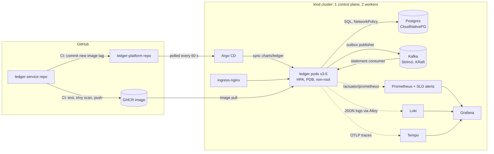
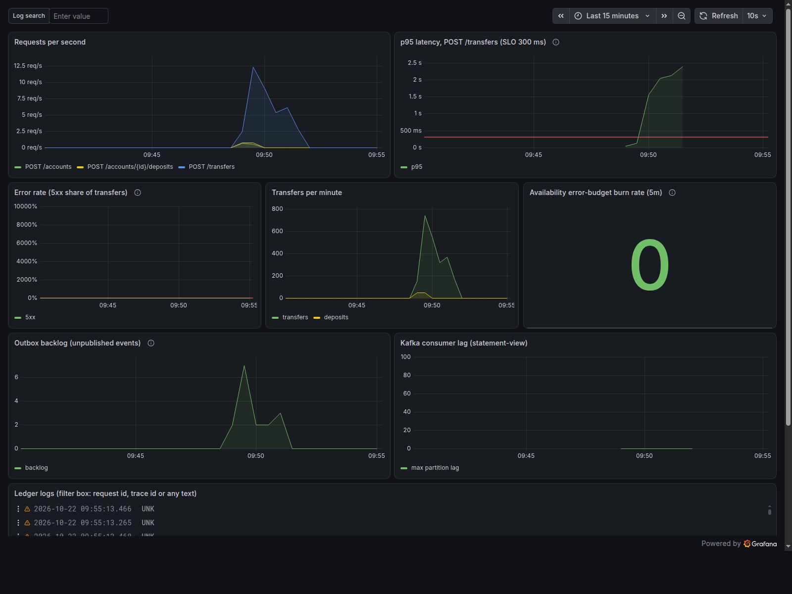
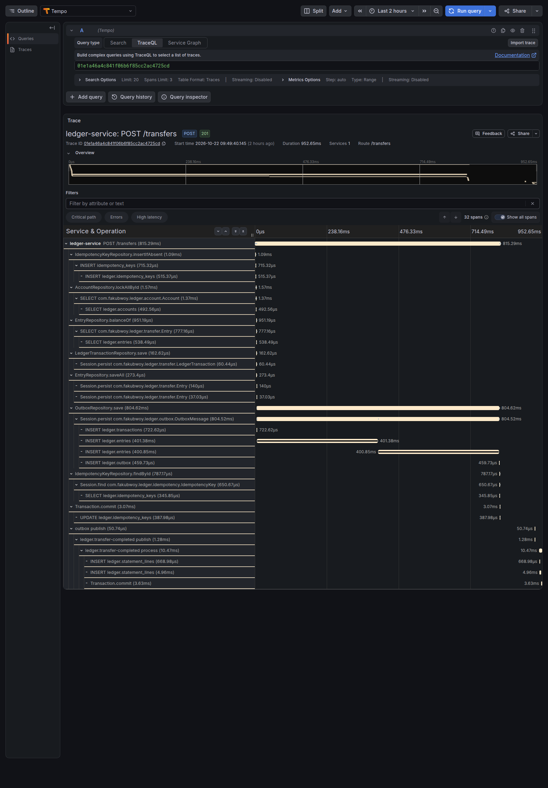

# ledger-platform

Kubernetes platform for [ledger-service](https://github.com/fakubwoy/ledger-service), a Java/Spring Boot payments
ledger with Postgres and Kafka. Everything runs on a laptop with kind, is deployed by Argo CD from this repo, and
is checked by scripts that write their results to [results/](results/).

The point of the project is evidence: every claim below links to the script that tests it and the output it
produced.

## Architecture



A transfer writes its entries, its idempotency key and an outbox row in one Postgres transaction. A poller on
every replica publishes outbox rows to Kafka (`FOR UPDATE SKIP LOCKED`, so replicas share the work without
sending the same row twice), and a consumer builds the statement view. The trace context is stored in the outbox
row, so one transfer is one trace from the HTTP request to the consumer.

## Quick start

Needs Docker, kind, kubectl and Helm. Measured on a fresh `make up`: 9.2 GiB of RAM for the kind nodes with
everything on (5 ledger replicas after the HPA reacted to JVM startup), 8.8 GiB with `LITE=1`. A fresh clone to a
healthy, Argo CD-synced ledger took 12.6 minutes for `make up` plus about 4 minutes for Postgres and the first
rollout.

```
make up            # cluster, ingress, metrics-server, CloudNativePG, Strimzi, observability, Argo CD
make up LITE=1     # same without Loki, Tempo and Alloy
make down
```

Argo CD then deploys the ledger from GitHub. The API is at http://localhost:8080 (ingress). Grafana, Prometheus
and Argo CD are reached with `kubectl port-forward`; see [docs/observability.md](docs/observability.md) and
[docs/gitops.md](docs/gitops.md).

The kind nodes on my network cannot use plain DNS, so `make up` starts a small DNS-over-TLS forwarder on the kind
network ([kind/helpers/fix-dns.sh](kind/helpers/fix-dns.sh)). On a normal network it is harmless.

## Results

| Milestone | Result | Evidence |
|---|---|---|
| Probes | Broke liveness, readiness and startup probes on purpose: restart, removal from endpoints, crash loop, while old pods kept serving | [results/m2-probe-breakage.txt](results/m2-probe-breakage.txt) |
| Persistence | Deleted the Postgres pod: same volume, balances unchanged | [results/m3-postgres-survives.txt](results/m3-postgres-survives.txt) |
| Autoscaling | 60 users of real transfers: HPA scaled 2 to 5 pods, 81,224 requests, 0 failed | [results/m5-hpa-k6.txt](results/m5-hpa-k6.txt) |
| Zero-downtime deploys | Rolling restart under load: 12 failed requests before, 0 after (maxUnavailable 0, preStop, graceful shutdown, PDB) | [results/m6-before.txt](results/m6-before.txt), [results/m6-after.txt](results/m6-after.txt) |
| Observability | Injected a slow query: burn-rate alert after 92 s, cause found from dashboard, trace and logs in the same minute | [docs/observability.md](docs/observability.md) |
| GitOps | `git push` to running pods in 312 s, rollback by `git revert` in 131 s, manual drift reverted in 4 s | [docs/gitops.md](docs/gitops.md) |
| Security | Non-root, read-only root filesystem, no capabilities, no API token, Postgres reachable only from the ledger, trivy gates in CI | [docs/security.md](docs/security.md) |
| Failure drills | Six drills under load (JVM SIGKILL, shared outbox with forced redelivery, Kafka down 11 min, Postgres crash and 60 s outage, slow database). Over 177,000 transfers: ledger sums to zero, no negative balances, every retried request applied exactly once, every event in the statement view once | [docs/failure-drills.md](docs/failure-drills.md) |
| Azure and GCP | Terraform for AKS and GKE with managed Postgres and Workload Identity, validated, not applied | [docs/cloud.md](docs/cloud.md) |

## Screenshots

The dashboard during the slow-query drill, and the trace that pointed at the cause (two 400 ms inserts):




## Repository layout

| Path | What |
|---|---|
| [charts/ledger](charts/ledger) | Helm chart: Deployment, Service, Ingress, HPA, PDB, NetworkPolicy, ServiceMonitor, SLO rules, dashboard, CloudNativePG and Strimzi resources. Values for dev, prod, AKS and GKE |
| [argocd](argocd) | The Argo CD Application that deploys the chart |
| [platform](platform) | Pinned, vendored manifests and charts for everything the ledger depends on |
| [kind](kind) | Cluster config and the DNS helper |
| [terraform](terraform) | AKS and GKE |
| [scripts](scripts), [loadtest](loadtest) | Load tests, fault injection and the failure drills |
| [results](results) | Raw output of every test |
| [k8s](k8s) | Hand-written manifests from before Helm, kept for reference |
| [docs](docs) | Write-ups per topic |

## What it does not do

- One Postgres primary. Losing it means the ledger is unavailable until CloudNativePG brings it back; the 3
  instance prod values add replicas and failover, which were not tested here.
- One region, one cluster. No multi-region failover.
- Kafka in dev is one broker with replication factor 1. Prod values use 3 brokers, RF 3, min ISR 2, untested.
- The cloud setups are validated designs, not deployments.
