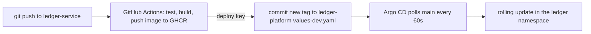

# GitOps

## The loop



- The cluster never receives `kubectl apply` or `helm upgrade` from a person or from CI. Argo CD pulls from git.
- CI can write to exactly one place: `ledger-platform`, through a deploy key scoped to that repo.
- The Argo CD [Application](../argocd/ledger.yaml) renders `charts/ledger` with `values-dev.yaml` from `main`.
  `selfHeal` reverts manual changes and `prune` deletes what is removed from git. It has no resources-finalizer, so
  deleting the Application does not delete the database or Kafka.

## Results

Raw log: [results/m8-gitops.txt](../results/m8-gitops.txt).

| What | Time |
|---|---|
| `git push` in ledger-service to new pods serving | 312 s (185 s of it is CI) |
| `git revert` of the tag bump to old pods serving | 131 s |
| manual `kubectl set image` reverted by Argo CD | 4 s |

## Rolling back

Revert the bump commit in this repo:

```
git revert <sha of "Deploy ledger-service sha-... to dev">
git push
```

This pins dev to the previous image. It is a pin, not a fix: the next push to ledger-service main builds a new
image and bumps the tag again. To keep the bad change out, revert it in ledger-service too.

## Laptop-only settings

[platform/argocd-config.yaml](../platform/argocd-config.yaml): 60 s polling instead of 180 s (a webhook would make
it instant but GitHub cannot reach a laptop), anonymous read-only UI, and plain HTTP behind `kubectl port-forward`.
